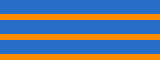

<svg>

  

</svg>

# README image test

Relative path, should load from GitHub:

GitHub raw URL, should load:

Badge on another host, should become a link:

External image as HTML, should become a link:

Picture with an external source, the source should be dropped and only the GitHub image load:

<picture><source srcset="https://picsum.photos/300"></picture>
